# Diagrams

A flowchart with a subgraph, several shapes and every edge style:

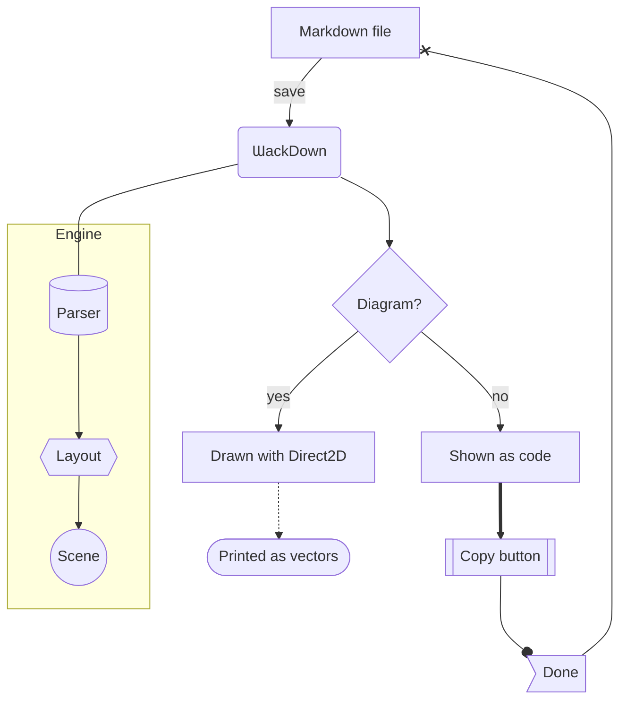

A sequence diagram:

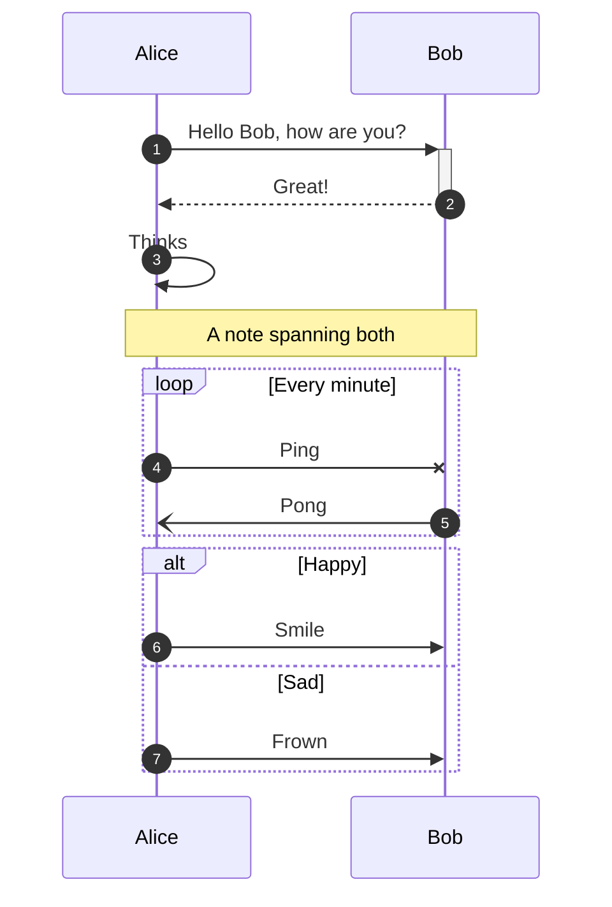

A class diagram:

```mermaid
classDiagram
    class Animal {
        +String name
        +int age
        +makeSound() void
        +isMammal()* bool
    }
    class Duck {
        +String beakColor
        +swim()
        +quack()
    }
    <<interface>> Swimmer
    Animal <|-- Duck
    Swimmer <|.. Duck
    Duck "1" *-- "many" Feather : has
    Duck o-- Pond
    Duck --> Food : eats
    Pond ..> Water
```

A state diagram:

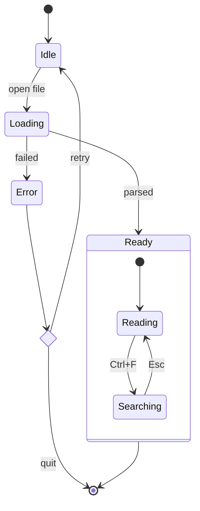

A pie chart:

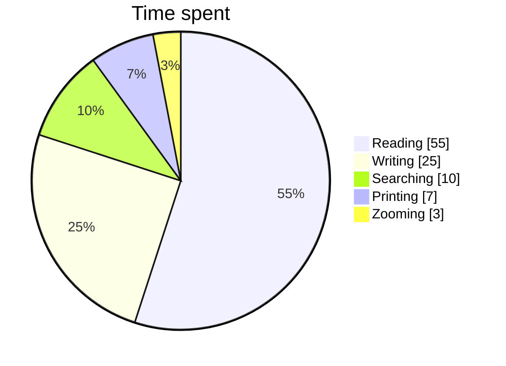

The newer flowchart syntax, an invisible link and a subgraph with its own direction:

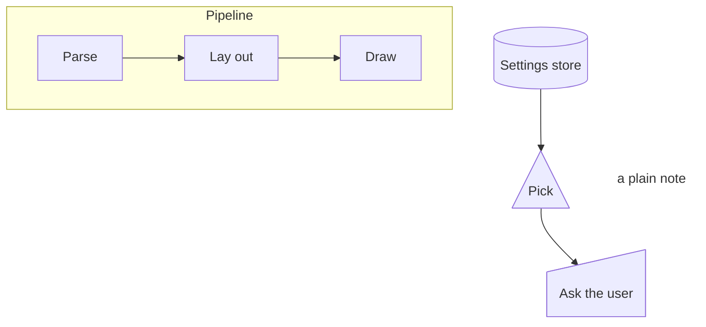

An entity relationship diagram:

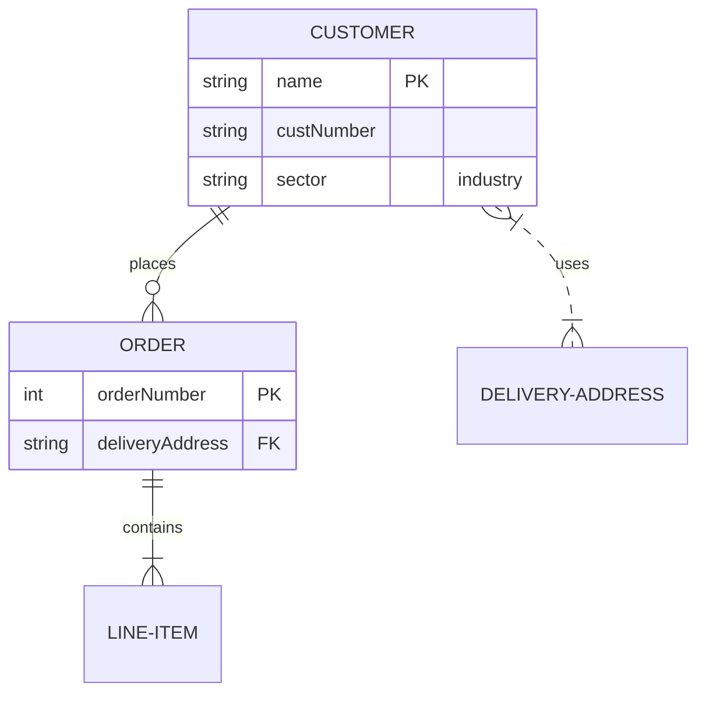

A Gantt chart:

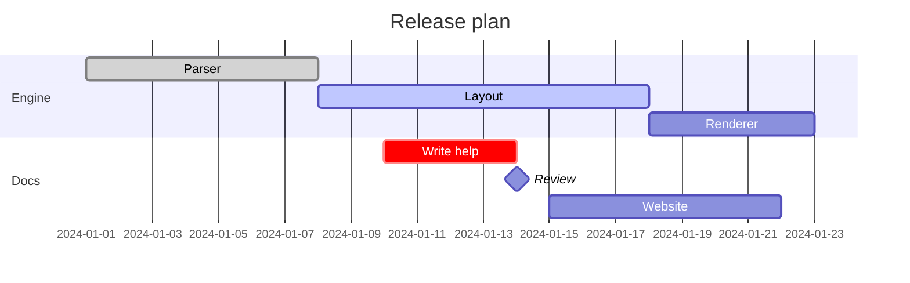

A git graph:

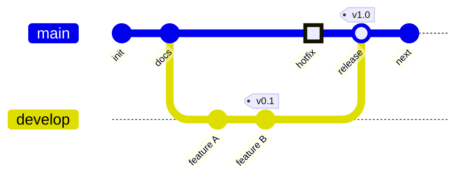

A mind map:

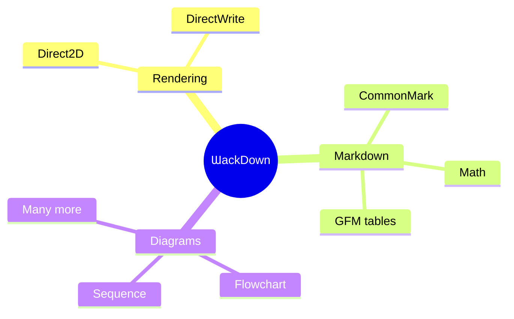

A timeline:

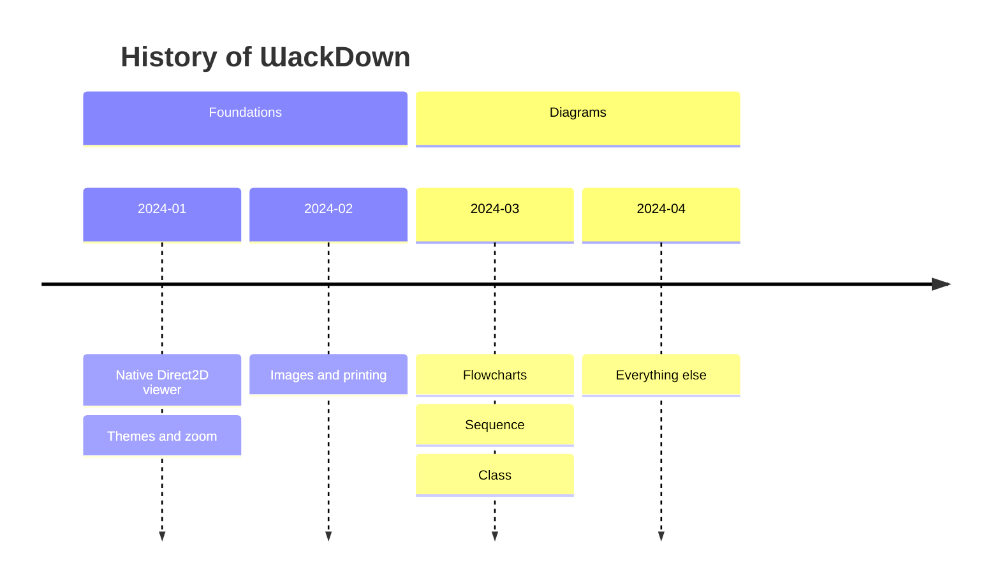

A user journey:

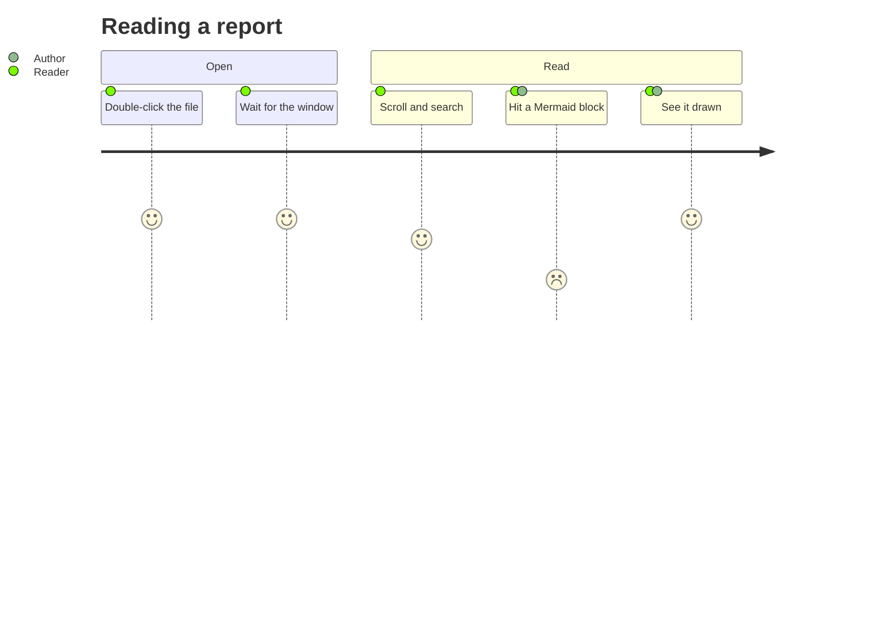

A quadrant chart:

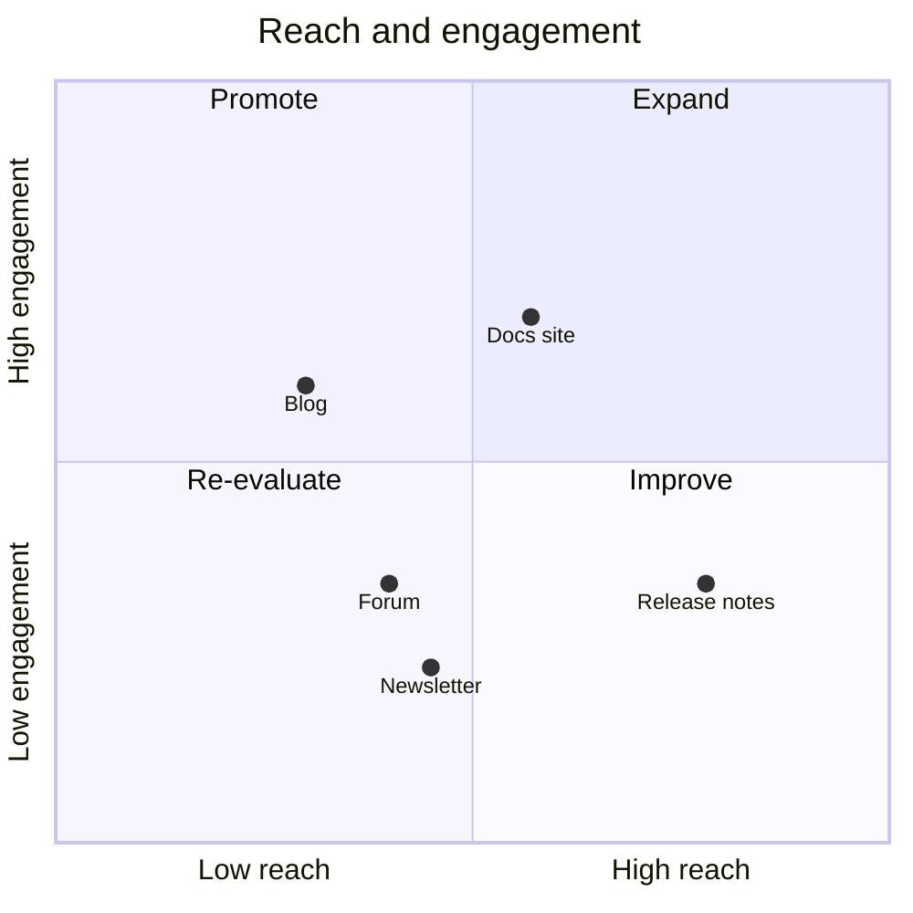

An XY chart:

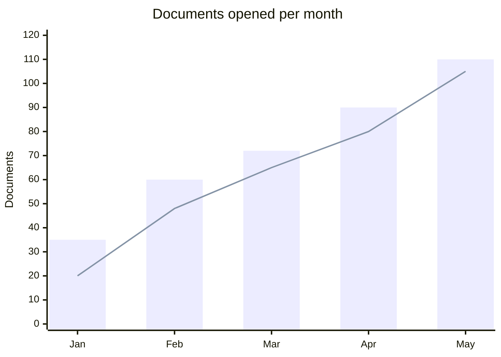

A broken one stays code:

```mermaid
graph TD
A -->
[[[
```

An unsupported type stays code:

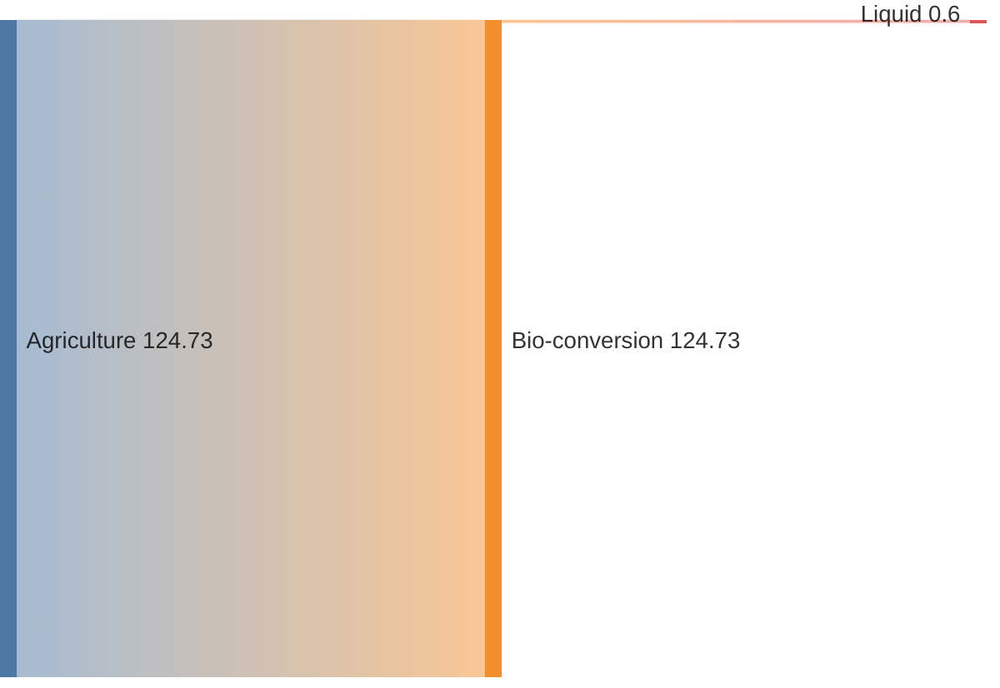

Text after.
